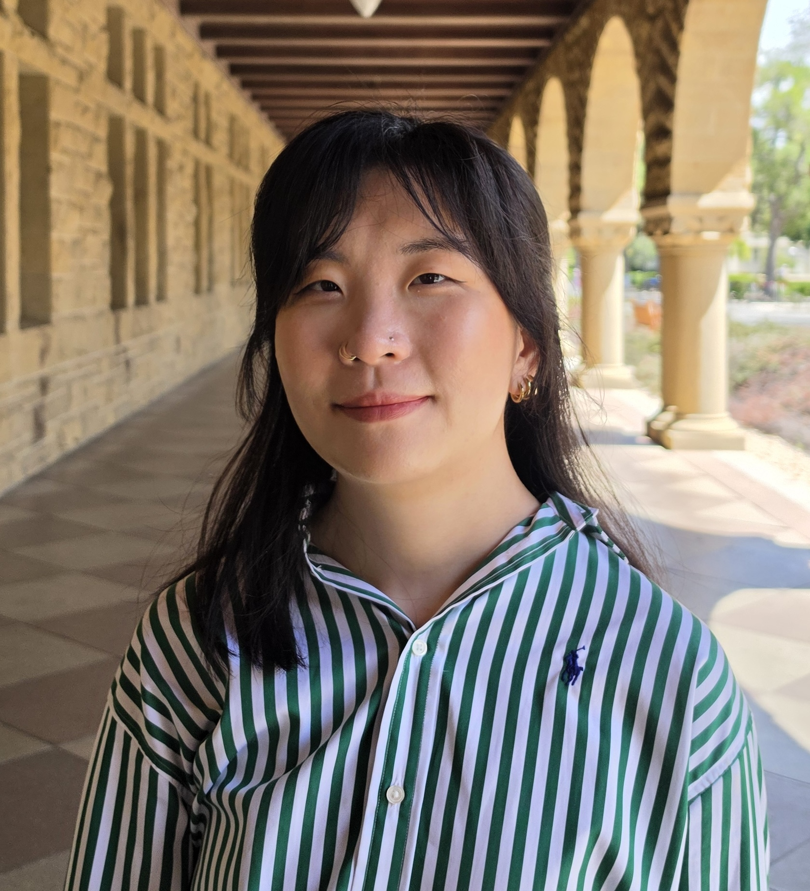

I am an experimental physical chemist working as a Systems Integration Engineer at [Picarro](https://www.picarro.com). I am interested in leveraging both my spectroscopy and machine learning experience to improve chemical sensing, detection, and characterization in industrial environments. Most recently, I was a postdoctoral researcher at Brookhaven National Laboratory, where I developed materials for solar energy conversion and quantum information science.

My expertise is in harnessing ultrafast spectroscopy (including transient absorption and electron accelerators) to study energy and charge transfer in chemical systems for renewable energy. Now, I am learning systems and hardware engineering that turns concepts into functioning products, ready for production. Recently, I have been working on using machine learning and high-performance computing to improve chemical detection.  

Inclusion in science is very important to me, and I have many experiences mentoring and teaching younger researchers to help them achieve their goals. Building community is key to improving the way we do science, and I have created many initiatives such as seminars and study groups to bring people together to work towards a common goal.

I am excited to leverage my technical, communication, and leadership skills to advance discoveries that will lead to a sustainable future for our society. If you are interested in discussing potential research collaborations or my teaching services, please feel free to contact me via email.

